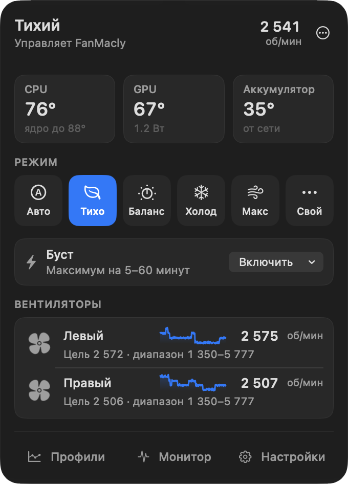

<p align="center"></p>

<h1 align="center">FanMacly</h1>

<p align="center">
  <a href="https://github.com/kdanet/FanMacly/actions/workflows/ci.yml"></a>
  <a href="LICENSE"></a>
  
  
</p>

<p align="center"><b><a href="https://kdanet.github.io/FanMacly/">kdanet.github.io/FanMacly</a></b></p>

> **English.** FanMacly is a free, open-source menu-bar app that controls the fans of Apple Silicon Macs. Pick Quiet, Balanced, Cool, Max or your own curve in one click. A privileged helper keeps that choice through sleep and restarts, and takes the fans back when macOS grabs them. Hard safety limits switch to full speed or hand the fans back to macOS when the chip gets too hot. The interface is in Russian for now; see the [project page](https://kdanet.github.io/FanMacly/) for an English overview.

Утилита в строке меню для мониторинга температур и управления вентиляторами Mac с **Apple Silicon**. Работает на macOS 14 и новее; Intel не поддерживается. Нет сетевых запросов, аккаунтов, аналитики и сторонних зависимостей.

<p align="center"></p>

## Возможности

- **Режимы в один клик**: Авто (macOS), Тихо, Баланс, Холод, Макс, а также свои профили и ручной режим.
- **Буст** на 5–60 минут из панели (1–240 минут из «Команд»): максимум оборотов, затем возврат к прежнему режиму.
- **Надёжное управление.** Выбранный режим хранит системный компонент. Режим переживает закрытие панели, сон, перезапуск приложения и короткие сбои датчиков. Если macOS забирает вентилятор, компонент возвращает его. Защитные возвраты временные: режим восстанавливается сам. Подробности — в [docs/control-policy.md](docs/control-policy.md).
- **Понятный статус**: значок в строке меню становится оранжевым, если выбранный режим сейчас не действует; баннеры с причиной и кнопкой «Вернуть», уведомления и журнал событий.
- **Редактор профилей**: точки кривой перетаскиваются на графике, шкала до 100 °C, рядом с процентами видны обороты, отмечена текущая рабочая точка.
- **Монитор**: история температур, оборотов и мощности GPU/CPU за час, понятный список датчиков, журнал событий.
- **Автоматизация**: режим по питанию (сеть, аккумулятор, энергосбережение) и по запущенным приложениям. Режимом можно управлять из «Команд», Siri и фильтров Фокусирования. На macOS 27 есть кнопки Пункта управления и виджет рабочего стола.
- **Конфликты**: FanMacly предупреждает, если вентиляторами управляет другое приложение (например, Macs Fan Control).

## Установка

1. Скачайте [FanMacly.zip](https://github.com/kdanet/FanMacly/releases/latest/download/FanMacly.zip) из [последнего релиза](https://github.com/kdanet/FanMacly/releases/latest). Сборка подписана Developer ID и нотаризована Apple.
2. Распакуйте архив, перенесите `FanMacly.app` в «Программы» и откройте.
3. Нажмите **Установить** в панели. macOS попросит разрешение в **Системные настройки → Основные → Объекты входа и расширения**.

При обновлении FanMacly сам заменит системный компонент, если сменился протокол (сейчас 1.0.6). Если не получится, в панели появится кнопка **Обновить**.

## Сборка из исходников

Нужен полный Xcode 27 (macOS SDK 27, Swift 6.4): сборка расширения и метаданных App Intents использует `xcodebuild` и `appintentsmetadataprocessor`, которых нет в Command Line Tools. XcodeGen нужен только при изменении `Controls.project.yml`.

```sh
bash scripts/build.sh                      # ad-hoc: только мониторинг
SIGN_IDENTITY='Developer ID Application: Your Name (TEAMID)' bash scripts/build.sh
```

Скопируйте `build/FanMacly.app` в `/Applications`, откройте и установите компонент, как описано выше.

У подписанной сборки виджет рабочего стола получает данные через App Group `TEAMID.app.fanmacly`; команда определяется по подписи. Ad-hoc сборка не может управлять root-компонентом.

Релиз для раздачи собирает `scripts/release.sh`: проверки, подпись Developer ID, нотаризация, `stapler`, проверка Gatekeeper и `build/release/FanMacly.zip` с контрольной суммой. Один раз сохраните учётные данные нотаризации: `xcrun notarytool store-credentials FanMacly --apple-id … --team-id …`.

```sh
SIGN_IDENTITY='Developer ID Application: Your Name (TEAMID)' bash scripts/release.sh
```

## Удаление

1. **Настройки → Компонент → Отключить** (или `/Applications/FanMacly.app/Contents/MacOS/FanMacly --unregister-helper`). Компонент вернёт вентиляторы macOS и будет удалён из launchd.
2. Удалите `FanMacly.app` из «Программ».
3. По желанию удалите сохранённое состояние компонента: `sudo rm -rf /var/db/app.fanmacly`.

## Разработка

```sh
bash scripts/check.sh                       # сборка + все тесты
bash scripts/preview.sh --panel-window      # изолированная копия UI (свой bundle ID, без компонента)
bash scripts/preview.sh --open-window=profiles|monitor|settings
bash scripts/preview.sh --open-window=settings --settings-tab=general|menuBar|automation|helper|diagnostics
bash scripts/soak-test.sh 30                # 30 минут наблюдения за регистрами SMC (только чтение)
.build/debug/fanmacly-probe --watch=60      # построчный журнал FnMd/Ftst/целей/температур
.build/debug/fanmacly-probe --power         # мощность через IOReport
```

| Модуль | Назначение |
|---|---|
| `SMCBridge` | C-мост к IOKit/AppleSMC |
| `FanMaclyCore` | модели, `ControlPolicy`, `ThermalGuard`, `ControlEngine`, `FanModeController`, `PowerSampler` |
| `FanMaclyHelper` | root-компонент: XPC, сохранённое намерение, журнал восстановления |
| `FanMacly` | приложение: `AppModel`, SwiftUI-панель и окна, App Intents, автоматизация |
| `FanMaclyControls` | WidgetKit: кнопки Пункта управления и виджет рабочего стола (Xcode-проект из `Controls.project.yml`) |
| `FanMaclyProbe` | диагностика только на чтение |

## Документация

- [docs/control-policy.md](docs/control-policy.md) — пороги, состояния, захват `Ftst`, автовозобновление.
- [CHANGELOG.md](CHANGELOG.md) — изменения.
- [CONTRIBUTING.md](CONTRIBUTING.md) — как собрать, проверить и прислать изменения; как переименовать идентификаторы в форке.
- [SECURITY.md](SECURITY.md) — как сообщить об уязвимости.
- [docs/history/](docs/history/) — анализ 0.9 и план 1.0, описание логики 0.9, протоколы аппаратных проверок 0.x.

## Ограничения и ответственность

FanMacly пишет в недокументированный интерфейс AppleSMC от имени root. Защитные пороги и возврат управления macOS проверены на M4 Max, но на других моделях поведение прошивки может отличаться. Программа распространяется «как есть», без гарантий (см. [LICENSE](LICENSE)).

Интерфейс AppleSMC не документирован Apple; ключи зависят от модели и прошивки. Неподдерживаемая запись завершается ошибкой, а не мнимым успехом. Счётчики мощности CPU (IOReport) на некоторых системах «замирают»; тогда FanMacly показывает пик температуры ядра вместо ватт.

## Источники

- Агрегаты CPU: [iSMC](https://github.com/dkorunic/iSMC/blob/master/smc/sensors.go), [OSHI #3535](https://github.com/oshi/oshi/pull/3535).
- Каналы датчиков: [Stats](https://github.com/exelban/stats/blob/master/Modules/Sensors/values.swift), [VirtualSMC](https://github.com/acidanthera/VirtualSMC/blob/master/Docs/SMCSensorKeys.txt).
- Передача управления на Apple Silicon: [исследование Ftst](https://github.com/agoodkind/macos-smc-fan/blob/main/docs/research.md), [MacGauge FanControl](https://github.com/StevenACZ/MacGauge/blob/main/Sources/MacFanCore/FanControl.swift), [sak0a/MacFanControl](https://github.com/sak0a/MacFanControl).
- Мощность: [macmon](https://github.com/vladkens/macmon).
- Apple: [SMAppService](https://developer.apple.com/documentation/servicemanagement/smappservice), [ProcessInfo.ThermalState](https://developer.apple.com/documentation/foundation/processinfo/thermalstate-swift.enum), [Human Interface Guidelines](https://developer.apple.com/design/human-interface-guidelines/designing-for-macos).

## Лицензия

[MIT](LICENSE).
